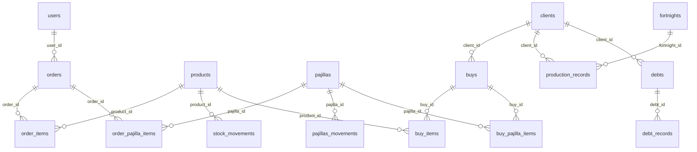

# ASOVARGAS — Sistema de gestión

Panel administrativo web de ASOVARGAS (Asociación Agroturística Pantano de Vargas), una asociación de productores de leche. Permite al personal de la asociación llevar el inventario de insumos y de pajillas de inseminación, registrar compras a proveedores y ventas a clientes con su remisión imprimible, administrar clientes y sus deudas, y registrar la leche entregada por cada productor dentro de una quincena para calcular cuánto se le paga. Es una aplicación Next.js 15 (App Router) que lee y escribe directamente en una base de datos Supabase (PostgreSQL); buena parte de la lógica de inventario vive en triggers de la base de datos, no en TypeScript.

Este documento describe el sistema **tal como está implementado en el código y en `scripts/`**. Donde el repositorio no permite responder algo, se indica como vacío conocido en lugar de suponerlo.

## Inicio rápido

```bash
pnpm install
# crear .env.local con las variables de la sección "Variables de entorno"
pnpm dev          # http://localhost:3000
```

Requisitos previos para que arranque y se pueda iniciar sesión:

1. Un proyecto Supabase con el esquema creado (ver [Base de datos](#base-de-datos); la instalación desde cero **no es reproducible solo con `scripts/`**).
2. Al menos una fila en la tabla `users` con la contraseña hasheada con bcrypt (ver [Alta de usuarios](#alta-de-usuarios-del-panel)).
3. `AUTH_SECRET` definido.

| Comando | Qué hace |
|---|---|
| `pnpm dev` | Servidor de desarrollo (`next dev`) |
| `pnpm build` | Compilación de producción (`next build`). No falla por errores de tipos ni de lint (ver [Deuda técnica](#problemas-conocidos-y-deuda-técnica)) |
| `pnpm start` | Sirve la compilación (`next start`) |
| `pnpm lint` | Ejecuta `next lint`. El repositorio no tiene ESLint como dependencia ni archivo de configuración, por lo que el comando no está operativo tal cual |

No hay pruebas automatizadas ni script `test`.

## Contenido

- [Qué hace y para quién](#qué-hace-y-para-quién)
- [Glosario del dominio](#glosario-del-dominio)
- [Stack](#stack)
- [Puesta en marcha local](#puesta-en-marcha-local)
- [Variables de entorno](#variables-de-entorno)
- [Mapa del repositorio](#mapa-del-repositorio)
- [Rutas](#rutas)
- [Acceso a datos](#acceso-a-datos)
- [Autenticación](#autenticación)
- [Base de datos](#base-de-datos)
- [Flujos de negocio](#flujos-de-negocio)
- [Reglas no evidentes](#reglas-no-evidentes)
- [Despliegue](#despliegue)
- [Cómo contribuir](#cómo-contribuir)
- [Problemas conocidos y deuda técnica](#problemas-conocidos-y-deuda-técnica)
- [Solución de problemas](#solución-de-problemas)
- [Vacíos conocidos](#vacíos-conocidos)
- [Estado de `DOCUMENTACION.md`](#estado-de-documentacionmd)

## Qué hace y para quién

Los usuarios del sistema son empleados o administradores de la asociación que inician sesión en el panel. Los productores y compradores **no** tienen acceso: son registros de la tabla `clients`.

| Módulo | Ruta | Para qué sirve |
|---|---|---|
| Productos | `/dashboard/productos` | Catálogo e inventario de insumos; cálculo del precio de venta |
| Órdenes | `/dashboard/ordenes` | Compras a proveedores (reabastecimiento). Suman stock |
| Pajillas | `/dashboard/pajillas` | Inventario de pajillas de inseminación, agrupado por canastilla |
| Ventas | `/dashboard/ventas` | Ventas a clientes y remisión imprimible. Restan stock |
| Usuarios | `/dashboard/usuarios` | Clientes (asociados y compradores) y sus deudas |
| Producción | `/dashboard/produccion` | Litros de leche entregados por cliente en la quincena activa |
| Variables | `/dashboard/variables` | Configuración de la quincena: fechas, precio por litro, cuota de sostenimiento |
| Estadísticas | `/dashboard/estadisticas` | Ventas por producto, por pajilla y por tipo de pago; egresos y balance |

## Glosario del dominio

Los nombres de tablas y de pantallas no coinciden entre sí. Esta tabla es la referencia.

| Término en la interfaz | En código / base de datos | Significado |
|---|---|---|
| Usuario (pantalla "Usuarios") | tabla `clients` | Cliente de la asociación. **No** es quien inicia sesión |
| Usuario del panel | tabla `users` | Cuenta con correo y contraseña para entrar al dashboard |
| Asociado | `clients.type_client = 'associate'` | Socio productor. Tiene cupo de crédito y paga cuota de sostenimiento |
| Comprador | `clients.type_client = 'buyer'` | Cliente no socio. Su cupo de crédito se guarda siempre en 0 |
| Venta / Remisión | tablas `buys`, `buy_items`, `buy_pajilla_items` | Venta **de la asociación a un cliente**. `buys` significa "compras del cliente" |
| Orden / Compra | tablas `orders`, `order_items`, `order_pajilla_items` | Compra de la asociación **a un proveedor**; reabastece inventario |
| Pajilla | tabla `pajillas` | Dosis de semen de un toro para inseminación artificial. Cada fila es un toro (`bull_name`) con su stock |
| Canastilla | `pajillas.canastilla_number` | Número del contenedor físico donde se guarda la pajilla. Solo sirve para agrupar el listado |
| Quincena | tabla `fortnights` | Periodo de liquidación de leche con sus precios. Solo una está activa a la vez (`is_active`) |
| Cuota de sostenimiento | `fortnights.sostenimiento_fee` | Descuento fijo por quincena que se aplica solo a asociados |
| Producción | tabla `production_records` | Litros entregados por un cliente en una fecha y hora |
| Deuda | tablas `debts`, `debt_records` | Deuda registrada manualmente a un cliente y su bitácora de cambios |
| Contado / Transferencia / Crédito | `buys.sale_type` (enum `sale_type`) | Forma de pago de una venta. Es solo una etiqueta (ver [Ventas](#ventas)) |

## Stack

| Área | Tecnología | Versión en `package.json` |
|---|---|---|
| Framework | Next.js (App Router) | `15.2.8` |
| UI | React | `^19` |
| Lenguaje | TypeScript (modo `strict`) | `^5` |
| Base de datos | Supabase (`@supabase/supabase-js`) | `latest` (2.101.1 en el lockfile) |
| Autenticación | next-auth (Auth.js v5) con proveedor de credenciales, `bcrypt`, `zod` | `5.0.0-beta.29` |
| Estado de servidor en cliente | TanStack Query | `^5.90.2` |
| Estilos | Tailwind CSS v4 mediante `@tailwindcss/postcss` | `^4.1.9` |
| Componentes | shadcn/ui (estilo `new-york`) sobre Radix UI, iconos `lucide-react` | — |
| Gráficas | Recharts | `2.15.4` |
| Notificaciones | `react-toastify` (y `sonner` en dos archivos, ver deuda técnica) | — |
| PDF | `jspdf` + `jspdf-autotable` (solo en un componente sin uso) | — |
| Gestor de paquetes | pnpm (`pnpm-lock.yaml`, `lockfileVersion: '9.0'`) | no fijado |

El proyecto se generó con v0.app: `package.json` conserva el nombre `my-v0-project` y quedan rastros como `generator: "v0.app"` en `app/layout.tsx` y mensajes `[v0]` en `app/dashboard/ordenes/[id]/page.tsx`.

## Puesta en marcha local

1. **Node.js y pnpm.** El repositorio no fija versión de Node (`engines`, `.nvmrc`) ni de pnpm (`packageManager`). `@types/node` está en `^22`.
2. **Dependencias:** `pnpm install`. `pnpm-workspace.yaml` desactiva los scripts de compilación de `bcrypt`, `sharp`, `@tailwindcss/oxide` y `core-js`. Si `bcrypt` no logra cargar su binario nativo al iniciar sesión, revise esa configuración.
3. **Entorno:** cree `.env.local` en la raíz (los archivos `.env*` están en `.gitignore`; no existe un `.env.example`).
4. **Base de datos:** ver [Base de datos](#base-de-datos).
5. **Usuario inicial:** ver [Alta de usuarios](#alta-de-usuarios-del-panel).
6. **Ejecutar:** `pnpm dev` y abrir `http://localhost:3000/login`.

## Variables de entorno

Son todas las que lee el código (búsqueda de `process.env` en el repositorio) más la que exige Auth.js.

| Variable | Obligatoria | Uso | Dónde se lee |
|---|---|---|---|
| `NEXT_PUBLIC_SUPABASE_URL` | Sí | URL del proyecto Supabase | `lib/supabase/client.ts:12-24`, `lib/supabase/server.ts:6-20` |
| `NEXT_PUBLIC_SUPABASE_ANON_KEY` | Sí | Clave anónima de Supabase. Se envía al navegador | Los mismos archivos |
| `AUTH_SECRET` | Sí | Secreto con el que Auth.js firma la sesión. El código no lo referencia: lo lee la librería | — |
| `WA_VERIFY_TOKEN` | Solo para el webhook | Token de verificación del webhook de WhatsApp | `app/api/whatsapp/webhook/route.ts:11` |

Si faltan las dos variables de Supabase, la aplicación no falla al arrancar: los clientes quedan en `null`, las páginas muestran "Error: Supabase no configurado" y el inicio de sesión devuelve credenciales inválidas (`auth.ts:10-13`).

El nombre de la clave cambió en el commit `17a0fac` ("RENAME ENVIRONMENT VARIABLES"). El código actual solo lee `NEXT_PUBLIC_SUPABASE_ANON_KEY`; cualquier otra variante del nombre que exista en un entorno no tiene efecto.

## Mapa del repositorio

```
app/
  layout.tsx                  Layout raíz: fuentes Geist, React Query, ToastContainer
  page.tsx                    Página pública de presentación
  login/page.tsx              Formulario de inicio de sesión (cliente)
  lib/actions.ts              Server Action authenticate() — único Server Action
  lib/definitions.ts          Tipo User usado por auth.ts (el resto es plantilla sin uso)
  providers/react-query-provider.tsx
  api/whatsapp/webhook/route.ts
  dashboard/
    layout.tsx                Cabecera común (DashboardHeader) + estilos del panel
    page.tsx                  Resumen
    loading.tsx, not-found.tsx
    productos/ ordenes/ pajillas/ ventas/ usuarios/ produccion/ estadisticas/ variables/
components/
  ui/                         Primitivas shadcn + pagination-controls.tsx (propio)
  ordenes/ pajillas/ produccion/ productos/ ventas/ estadisticas/
  *.tsx                       Componentes de la primera etapa (dashboard, productos, usuarios, deudas, navegación)
hooks/use-client.ts           Hooks de React Query
lib/
  supabase/client.ts          Cliente singleton + funciones de consulta (quincenas, producción)
  supabase/server.ts          Cliente para Server Components
  types.ts                    Interfaces del dominio
  utils.ts                    cn()
auth.ts, auth.config.ts, middleware.ts
scripts/                      SQL del esquema (ver Base de datos)
styles/globals.css            Tema global (lo importa app/layout.tsx)
public/                       asovargasLogo.png y recursos de plantilla
DOCUMENTACION.md              Documentación anterior, parcialmente desactualizada
implementation_plan.md        Plan original del módulo de ventas
```

`.agents/`, `.atl/` y `skills-lock.json` son configuración de asistentes de IA (una skill de buenas prácticas de Supabase/Postgres y un registro de skills autogenerado). No forman parte de la aplicación.

## Rutas

"Servidor" indica un Server Component que consulta Supabase al renderizar; "Cliente" indica un componente con `"use client"` que consulta desde el navegador.

| Ruta | Propósito | Página | Componentes principales |
|---|---|---|---|
| `/` | Presentación pública | `app/page.tsx` (servidor, estática) | — |
| `/login` | Inicio de sesión | `app/login/page.tsx` (cliente) | `authenticate` |
| `/dashboard` | Resumen | `app/dashboard/page.tsx` (servidor) | `DashboardStats`, `RecentOrders`, `ProductsOverview` (servidor) |
| `/dashboard/productos` | Listado | `productos/page.tsx` (servidor) | `ProductsList` (servidor), `DeleteProductButton` (cliente) |
| `/dashboard/productos/nuevo` | Alta | `productos/nuevo/page.tsx` | `ProductForm` (cliente) |
| `/dashboard/productos/[id]/editar` | Edición | `productos/[id]/editar/page.tsx` (servidor) | `ProductForm` |
| `/dashboard/ordenes?page=` | Listado paginado | `ordenes/page.tsx` (servidor) | `OrdersList` (servidor), `PaginationControls` (cliente) |
| `/dashboard/ordenes/nueva` | Alta | `ordenes/nueva/page.tsx` | `OrderForm` (cliente) |
| `/dashboard/ordenes/[id]` | Detalle y recibo | `ordenes/[id]/page.tsx` (servidor) | `OrderDetails`, `OrderInvoice` (cliente) |
| `/dashboard/pajillas` | Listado por canastilla | `pajillas/page.tsx` (servidor) | `PajillasList` (servidor), `DeletePajillaButton` (cliente) |
| `/dashboard/pajillas/nueva` | Alta | `pajillas/nueva/page.tsx` | `PajillaForm` (cliente) |
| `/dashboard/pajillas/[id]/editar` | Edición | `pajillas/[id]/editar/page.tsx` (servidor) | `PajillaForm` |
| `/dashboard/ventas?page=&saleType=&clientId=&year=&month=&period=` | Historial, resumen por cliente o por período | `ventas/page.tsx` (servidor) | `VentasList` (servidor), `ClientSalesSelector`, `PeriodFilter` y `DownloadRemisionesPDF` (cliente) |
| `/dashboard/ventas/nueva` | Alta | `ventas/nueva/page.tsx` | `VentaForm` (cliente) |
| `/dashboard/ventas/[id]` | Remisión imprimible | `ventas/[id]/page.tsx` (servidor) | `VentaInvoice` (cliente) |
| `/dashboard/usuarios` | Clientes y totales de deuda | `usuarios/page.tsx` | `UsersStats`, `UsersList` (cliente) |
| `/dashboard/usuarios/nuevo` | Alta de cliente | `usuarios/nuevo/page.tsx` | `UserForm` (cliente) |
| `/dashboard/usuarios/[id]` | Ficha y deudas | `usuarios/[id]/page.tsx` | `UserDetails`, `UserDebts`, `AddDebtDialog` (cliente) |
| `/dashboard/produccion` | Litros por cliente en la quincena activa | `produccion/page.tsx` (cliente) | `components/produccion/user-list.tsx`, `AddProductionModal` |
| `/dashboard/produccion/[id]` | Liquidación estimada e historial del cliente | `produccion/[id]/page.tsx` | `UserProductionHistory` (cliente, React Query), `EditProductionModal` |
| `/dashboard/estadisticas` | Indicadores | `estadisticas/page.tsx` (servidor) | `EstadisticasStats`, `VentasPorProducto`, `VentasPorPajilla`, `VentasPorTipo` (servidor); gráficas (cliente) |
| `/dashboard/variables` | Configuración de quincena | `variables/page.tsx` (cliente) | — |
| `/api/whatsapp/webhook` | Webhook (GET y POST) | `app/api/whatsapp/webhook/route.ts` | — |

Las páginas con datos declaran `export const dynamic = "force-dynamic"`, por lo que no se cachean.

No existen pantallas para editar un cliente, eliminar una venta o una orden, ni administrar las cuentas de `users`.

## Acceso a datos

No hay capa de API propia ni ORM. Toda consulta va directo a Supabase con la clave anónima, desde dos puntos:

| Cliente | Archivo | Quién lo usa |
|---|---|---|
| `createServerClient()` (envuelto en `cache` de React) | `lib/supabase/server.ts` | Server Components: listados, detalles, estadísticas. Solo lectura |
| `supabase` (singleton de módulo) | `lib/supabase/client.ts:30` | Componentes cliente: **todas las escrituras** (formularios, eliminaciones, deudas, producción, quincenas) y varias lecturas. También lo importa `auth.ts` en el servidor |

Ambos se crean con `NEXT_PUBLIC_SUPABASE_URL` y `NEXT_PUBLIC_SUPABASE_ANON_KEY`. No se usa clave de servicio ni la sesión de Supabase Auth: la base de datos no sabe qué usuario del panel hace cada operación.

`lib/supabase/client.ts` también concentra las funciones de consulta de producción y quincenas: `getClientById`, `getProductionHistory`, `getCurrentFortnight`, `upsertFortnight`, `finishFortnight`, y dos funciones heredadas (`getVariablesLiters`, `getVariablesFortnight`).

**React Query** se usa en un único lugar: `hooks/use-client.ts`, consumido por `UserProductionHistory`. El `QueryClient` se crea en `app/providers/react-query-provider.tsx` con `staleTime` de 5 minutos y sin refetch al enfocar la ventana; la caché vive en memoria. El resto de componentes cliente usa `useEffect` + `useState`.

**Server Actions:** solo existe `authenticate()` en `app/lib/actions.ts`, que llama a `signIn('credentials', formData)` y traduce el error a un mensaje.

Tras una escritura, los formularios llaman a `router.push()` + `router.refresh()`; algunos componentes antiguos usan `window.location.reload()` (`components/add-debt-client.tsx:81`).

## Autenticación

### Flujo de inicio de sesión

1. `app/login/page.tsx` envía el formulario (`email`, `password`, y `redirectTo=/dashboard` oculto) al Server Action `authenticate` mediante `useActionState`.
2. `authenticate` llama a `signIn('credentials', formData)` (`app/lib/actions.ts`).
3. `authorize()` en `auth.ts:32-66` valida con zod (correo válido, contraseña de 6 caracteres o más), busca la fila en `users` por correo usando el cliente Supabase con clave anónima y compara la contraseña con `bcrypt.compare`.
4. Si coincide devuelve `{ id, name, email }` y Auth.js crea la sesión. Si no, `authenticate` devuelve `"Invalid credentials."` (mensaje en inglés) y la página lo muestra.

### Qué se protege

`middleware.ts` ejecuta el callback `authorized` de `auth.config.ts:10-20` en todas las rutas salvo las que empiezan por `api`, `_next/static`, `_next/image` o terminan en `.png`.

| Situación | Resultado |
|---|---|
| Sin sesión, ruta `/dashboard/*` | Redirección a `/login` |
| Con sesión, ruta `/dashboard/*` | Acceso |
| Con sesión, cualquier otra ruta (incluidas `/` y `/login`) | Redirección a `/dashboard` |
| Sin sesión, cualquier otra ruta | Acceso |
| `/api/*` | El middleware no interviene: el webhook de WhatsApp es público |

La configuración está partida en dos archivos porque el middleware no puede cargar `bcrypt`: `auth.config.ts` contiene solo páginas y callbacks, y `auth.ts` añade el proveedor de credenciales.

### Sesión

No se configura estrategia ni duración: aplican los valores por defecto de Auth.js. No hay roles ni permisos; toda cuenta de `users` tiene acceso completo. `signOut` se exporta en `auth.ts:29` pero **no hay botón de cierre de sesión** en la interfaz.

La protección es únicamente de navegación: la base de datos se consulta con la clave anónima y no valida la sesión (ver [Deuda técnica](#seguridad)).

### Alta de usuarios del panel

No hay pantalla ni script para crear cuentas. Hay que insertar la fila manualmente en `users` (`name`, `email`, `password`) con la contraseña ya hasheada con bcrypt. El repositorio no documenta cómo se creó la cuenta existente.

Además, `components/ordenes/order-form.tsx:157` asigna todas las órdenes a un `user_id` fijo. En una base de datos nueva ese UUID no existirá y la creación de órdenes fallará por la clave foránea hasta que se cambie el valor o se cree un usuario con ese `id`.

## Base de datos

### Scripts

| Archivo | Define | Depende de |
|---|---|---|
| `scripts/01-create-tables.sql` | `products`, `orders`, `order_items`, `stock_movements`, `users`; triggers de stock y total de órdenes; `update_updated_at_column()` | — (pero ver nota) |
| `scripts/script-production.sql` | `clients`, `production_records`, `debts`, `debt_records`; `log_debt_changes()` | — |
| `scripts/enterprise.sql` | `enterprise`, `income`, `expense`, `buys`, `buy_items`; triggers de stock en ventas de productos | `clients`, `products`, `stock_movements` |
| `scripts/02-create-pajillas.sql` | `pajillas`, `pajillas_movements`; bitácora de cambios de stock de pajillas; RLS | `update_updated_at_column()` |
| `scripts/03-create-ventas.sql` | `buy_pajilla_items`; triggers de stock de pajillas en ventas; `update_buy_total()`; RLS | `buys`, `buy_items`, `pajillas` |
| `scripts/04-add-sale-type.sql` | tipo enum `sale_type` y columna `buys.sale_type` | `buys` |
| `scripts/05. migracion.sql` | `fortnights`, `production_records.fortnight_id`, `debt_payment`, `invoice_client_fortnight` | `production_records`, `debts`, `clients` |
| `scripts/06-order-pajilla-items.sql` | `pajillas.canastilla_number`, `order_pajilla_items`; triggers de stock; redefine `update_order_total()`; RLS | `pajillas`, `orders` |
| `scripts/anotation.md` | Una nota de negocio suelta, sin SQL | — |

**El orden de ejecución no está documentado.** La columna "Depende de" permite deducir uno posible (`01` → `script-production` → `enterprise` → `02` → `03` → `04` → `05` → `06`), pero no ha sido probado y los scripts tienen defectos que impiden una instalación limpia:

- `01-create-tables.sql` crea `orders` (línea 16, con clave foránea a `users`) antes de crear `users` (línea 49). En una base vacía falla salvo que `users` exista de antemano.
- `05. migracion.sql` crea la tabla `fortnights` (línea 13) pero el resto del archivo referencia `fortnight` en singular: comentarios sobre columnas que no existen (líneas 47-51), claves foráneas (60, 80, 106) y RLS (144-146). Todo va dentro de `BEGIN … COMMIT`, de modo que tal como está escrito el script aborta y no aplica nada. El código de la aplicación usa `fortnights` con las columnas de las líneas 13-23.
- Varios scripts no son idempotentes: `CREATE TABLE users`, `enterprise`, `income`, `expense` sin `IF NOT EXISTS`; `CREATE TYPE sale_type`; todos los `CREATE POLICY`.
- `CREATE OR REPLACE TRIGGER` requiere PostgreSQL 14 o superior.
- El código consulta objetos que **ningún script actual define**: las tablas `variables` y `fortnight_variables` (`lib/supabase/client.ts:47`, `:146`) y la función `archive_production_records()` (`components/produccion/download-production-pdf.tsx:65`). Sus definiciones existieron en archivos eliminados (`scripts/create_variables_table.sql`, eliminado en el commit `59e2db6`; `scripts/quincena.sql`, eliminado en `9b7ca08`) y se pueden recuperar con `git show <commit>^:<ruta>`.

No hay forma de saber desde el repositorio si la base de datos desplegada coincide con estos scripts. Antes de cualquier migración conviene exportar el esquema real desde Supabase.

### Modelo



| Tabla | Propósito | Script | Usada por la aplicación |
|---|---|---|---|
| `users` | Cuentas del panel (`email` único, `password` con hash bcrypt) | `01` | Sí (inicio de sesión) |
| `clients` | Asociados y compradores. PK `client_id`; `document` único; `phone` exige exactamente 10 dígitos; `credits` es el cupo de crédito | `script-production` | Sí |
| `products` | Insumos: precios, gastos, porcentaje de utilidad (0–100), `quantity` ≥ 0 | `01` | Sí |
| `pajillas` | Un toro por fila: raza, empresa, precios, `quantity` ≥ 0, `canastilla_number` (por defecto 1) | `02`, `06` | Sí |
| `orders` | Cabecera de compra a proveedor. `order_number` único, `status`, `total_amount` | `01` | Sí |
| `order_items`, `order_pajilla_items` | Renglones de una orden. `total_price` es columna generada (`quantity * unit_price`) | `01`, `06` | Sí |
| `buys` | Cabecera de venta. `buy_number` autoincremental, `sale_type`, `total_amount` | `enterprise`, `04` | Sí |
| `buy_items`, `buy_pajilla_items` | Renglones de una venta. `total_price` generado | `enterprise`, `03` | Sí |
| `stock_movements`, `pajillas_movements` | Bitácoras de inventario escritas por triggers | `01`, `02` | Solo escritura por triggers; ninguna pantalla las lee |
| `production_records` | Litros por cliente y fecha, con `fortnight_id` (nulable) | `script-production`, `05` | Sí |
| `fortnights` | Quincena: `start_date`, `end_date`, `price_liter_associate`, `price_liter_buyer`, `sostenimiento_fee`, `is_active` | `05` | Sí |
| `debts` | Deuda de un cliente: `total`, `status` (`pending`, `paid`, `cancelled`), `date` | `script-production` | Sí |
| `debt_records` | Bitácora de `debts` escrita por trigger | `script-production` | Solo escritura por trigger |
| `enterprise`, `income`, `expense` | Parámetros y caja de la asociación | `enterprise` | No |
| `debt_payment`, `invoice_client_fortnight` | Abonos por quincena y factura de quincena por cliente | `05` | No |
| `variables`, `fortnight_variables` | Parámetros del sistema de quincenas anterior | Ninguno actual | Se consultan, pero el resultado no se usa |

Al eliminar: los renglones caen en cascada con su cabecera; un producto o una pajilla con renglones asociados **no se puede eliminar** (`ON DELETE RESTRICT`); eliminar un cliente elimina en cascada sus ventas, producción y deudas.

### Triggers y funciones

| Se dispara con | Función | Efecto | Script |
|---|---|---|---|
| `AFTER INSERT` en `order_items` | `update_product_quantity_on_order()` | Suma al stock del producto; registra movimiento `order` | `01` |
| `AFTER UPDATE` / `DELETE` en `order_items` | `handle_product_quantity_on_order_update()` / `_delete()` | Ajusta el stock por la diferencia; registra `adjustment` | `01` |
| `AFTER INSERT/UPDATE/DELETE` en `order_pajilla_items` | `handle_pajilla_stock_on_order_insert()` / `_update()` / `_delete()` | Suma o resta stock de la pajilla; registra `increase` / `decrease` | `06` |
| `AFTER INSERT/UPDATE/DELETE` en `order_items` y `order_pajilla_items` | `update_order_total()` | Recalcula `orders.total_amount` sumando ambos tipos de renglón | `01`, redefinida en `06` |
| `BEFORE INSERT` en `buy_items` | `handle_product_stock_on_buy()` | Si no hay stock suficiente lanza excepción; si hay, descuenta y registra `sale` | `enterprise` |
| `BEFORE UPDATE` / `DELETE` en `buy_items` | `handle_product_stock_on_buy_update()` / `_delete()` | Ajusta o devuelve stock | `enterprise` |
| `BEFORE INSERT/UPDATE/DELETE` en `buy_pajilla_items` | `handle_pajilla_stock_on_buy()` / `_update()` / `_delete()` | Igual que productos, sobre `pajillas`. No escriben la bitácora directamente | `03` |
| `AFTER INSERT/UPDATE/DELETE` en `buy_items` y `buy_pajilla_items` | `update_buy_total()` | Recalcula `buys.total_amount` | `03` |
| `AFTER UPDATE` en `pajillas` | `handle_pajilla_quantity_update()` | Registra en `pajillas_movements` cualquier cambio de `quantity`, venga de donde venga | `02` |
| `AFTER INSERT OR UPDATE` en `debts` | `log_debt_changes()` | Escribe en `debt_records`: `created`, `payment`, `cancelled` o `update` | `script-production` |
| `BEFORE UPDATE` en `products`, `orders`, `pajillas`, `clients`, `production_records`, `debts`, `invoice_client_fortnight` | `update_updated_at_column()` | Actualiza `updated_at` | `01`, `script-production` |
| `BEFORE UPDATE` en `fortnights` | `update_fortnight_updated_at()` | Actualiza `updated_at` | `05` |

### Seguridad a nivel de fila

Los scripts activan RLS en `pajillas`, `buy_pajilla_items` y `order_pajilla_items` con una política `FOR ALL USING (true) WITH CHECK (true)`, que permite todo a cualquier rol. Para el resto de tablas no hay ninguna sentencia de RLS. El inicio de sesión lee `users` con la clave anónima; por tanto, si funciona en producción, esa tabla es legible por el rol anónimo. Las políticas reales de la base desplegada no constan en el repositorio.

## Flujos de negocio

### Productos

`components/productos/product-form.tsx`. El precio de venta no se escribe: se calcula y se guarda como

```
sale_price = (purchase_price + expenses) × (1 + profit_percentage / 100) × 1.05
```

(línea 36). El campo de gastos se precarga con `3850` en productos nuevos (línea 28). El formulario **no envía `quantity`** (líneas 49-56): un producto nace con stock 0 y el stock solo cambia mediante órdenes y ventas.

### Órdenes (reabastecimiento)

`components/ordenes/order-form.tsx`.

1. Se eligen productos y pajillas; el precio unitario se precarga con el precio de compra.
2. Se inserta la cabecera en `orders` con número `ORD-AAAAMMDD-NNNN` (los últimos cuatro dígitos del timestamp en milisegundos, líneas 92-99), el `status` elegido (por defecto `completed`) y el `user_id` fijo.
3. Se insertan los renglones en `order_items` y `order_pajilla_items`.
4. Los triggers suman el stock y recalculan el total.

El detalle (`/dashboard/ordenes/[id]`) incluye un recibo imprimible (`OrderInvoice`) con firmas de recepcionista y proveedor.

### Pajillas y canastillas

`components/pajillas/pajilla-form.tsx` permite fijar directamente `quantity` y `canastilla_number`, además de los precios de compra y venta (aquí el precio de venta sí se escribe a mano). La raza se elige de una lista fija en el propio archivo (`RAZAS_COLOMBIA`, líneas 24-54).

`components/pajillas/pajillas-list.tsx` agrupa por `canastilla_number` las pajillas con stock y muestra aparte, en "Pajillas Vacías", las que tienen stock 0 (líneas 34-47). La canastilla no es una entidad: es solo un número en la fila de la pajilla. El parámetro `page` que recibe el componente se ignora; el listado no está paginado.

### Ventas

`components/ventas/venta-form.tsx`.

1. Carga clientes, y solo productos y pajillas con `quantity > 0` (líneas 56-60).
2. El precio unitario se precarga con `sale_price` y es editable.
3. Valida en el navegador que la cantidad no supere el stock cargado.
4. Inserta la cabecera en `buys` con `client_id`, `sale_type` y `total_amount` (líneas 181-191).
5. Inserta `buy_items` y luego `buy_pajilla_items` (líneas 204 y 217). Los triggers validan el stock de forma definitiva, lo descuentan y recalculan el total.
6. Redirige a `/dashboard/ventas/[id]`, que muestra la remisión (`VentaInvoice`) e imprime con `window.print()` en tamaño carta.

**El tipo de venta es solo una etiqueta.** Una venta a `credito` no crea una fila en `debts`, no consulta ni descuenta el cupo `clients.credits`, y no cambia nada más: ni el código ni los triggers lo hacen. Si una venta a crédito debe quedar como deuda, hay que registrarla aparte desde la ficha del cliente.

El historial (`components/ventas/ventas-list.tsx`) pagina de 10 en 10 y filtra por `saleType`. Si la URL trae `clientId`, en lugar del historial muestra un resumen de ese cliente: totales por tipo de pago, productos comprados e historial. Ese resumen agrega solo `buy_items`; las pajillas vendidas no aparecen en la tabla de productos.

**Filtro por período.** `PeriodFilter` (`components/ventas/period-filter.tsx`) escribe `year`, `month` y `period` en la URL. `period` acepta cuatro valores: `month` (mes completo), `q1` (1ra quincena, días 1–15), `q2` (2da quincena, día 16 hasta el fin de mes) y `year` (año completo). Con un `period` válido, `VentasList` filtra `buys.created_at` al rango y muestra, arriba del historial, los totales del período completo por tipo de pago (total, contado, transferencia y crédito). La división es por calendario y no usa la tabla `fortnights`. Toda la lógica de rangos, etiquetas y slugs vive en `lib/periods.ts` (`resolvePeriodRange`, `periodSlug`) y la comparten el listado y el PDF. Los límites se calculan con offset fijo `-05:00` (Colombia no tiene horario de verano) y el fin del rango es exclusivo, para que ningún día caiga en dos períodos. Los totales se suman sobre **todo el período**, no sobre la página paginada; si además hay `saleType`, el desglose de totales sigue mostrando todos los tipos. El filtro de `saleType` no se combina con `clientId` (el resumen por cliente tiene prioridad); cuando hay `clientId`, el filtro de período y el botón de descarga se ocultan.

**Descarga de remisiones en PDF.** `DownloadRemisionesPDF` (`components/ventas/download-remisiones-pdf.tsx`) toma el mismo período de la URL, trae las `buys` del rango con sus `clients`, `buy_items`+`products` y `buy_pajilla_items`+`pajillas`, y arma un PDF con `jspdf` + `jspdf-autotable`: **una remisión por página**, con el diseño de `VentaInvoice` (encabezado, datos del comprador, tablas de productos/pajillas, total y firmas) más el pie "Página i de N". Se guarda como `remisiones-<periodo>.pdf` (slug de `lib/periods.ts`).

Este filtro y la descarga son solo de reporte: no crean deuda, no liquidan nada y no cambian ninguna fila de `buys`.

### Clientes y deudas

- Alta en `components/user-form.tsx`: exige nombre, documento, tipo y teléfono de 10 dígitos. El cupo de crédito solo se guarda para asociados (línea 56).
- Deudas en `components/add-debt-client.tsx` y `components/user-debts.tsx`: se registran manualmente con descripción, monto y fecha. Una deuda pendiente solo puede marcarse completa como `paid` o `cancelled` (línea 59). **No hay abonos parciales.** El trigger deja constancia en `debt_records`.

### Producción y quincenas

La quincena se administra a mano; no hay automatismo por fechas.

1. **Configurar** en `/dashboard/variables`: fechas de inicio y fin, precio por litro para asociados y para compradores, y cuota de sostenimiento. Si no hay quincena activa se crea una con `is_active = true`; si la hay, se actualiza (`upsertFortnight`, `lib/supabase/client.ts:95-131`).
2. **Registrar litros** en `/dashboard/produccion`: `AddProductionModal` inserta en `production_records` con el `fortnight_id` de la quincena activa. Sin quincena activa el botón queda deshabilitado (`components/produccion/production-modal.tsx:40-44`). El listado suma por cliente solo los registros de esa quincena.
3. **Consultar la liquidación** en `/dashboard/produccion/[id]` (`components/produccion/user-production-history.tsx:53-61`):

   ```
   total a pagar = litros de la quincena × precio por litro según tipo de cliente
   total neto    = total a pagar − cuota de sostenimiento (solo asociados)
   ```

   Es un cálculo en pantalla. No se guarda en ninguna tabla.
4. **Finalizar** en `/dashboard/variables`: pide una contraseña comprobada en el navegador y ejecuta `finishFortnight`, que únicamente pone `is_active = false` (`lib/supabase/client.ts:133-140`).

Lo que **no** ocurre al finalizar: no se generan liquidaciones ni facturas, no se descuentan deudas, no se archivan ni se borran registros. Los registros quedan en `production_records` ligados a la quincena cerrada, pero ninguna pantalla permite consultar quincenas anteriores. Las tablas `debt_payment` e `invoice_client_fortnight` de `05. migracion.sql` apuntan a una liquidación con deudas que no está implementada.

### Estadísticas

`components/estadisticas/`. Todo se calcula en el servidor trayendo las filas completas y sumando en JavaScript.

| Indicador | Cálculo |
|---|---|
| Ventas totales / Ingresos totales | Conteo y suma de `buys.total_amount`, sin filtro de fecha ni de tipo de pago |
| Productos / Pajillas vendidos | Suma de `quantity` en `buy_items` / `buy_pajilla_items` |
| Inventario productos / pajillas | Suma de `purchase_price × quantity` del stock actual |
| Valor total inventario | Inventario de productos + inventario de pajillas, a costo |
| Valor de venta potencial | Suma de `sale_price × quantity` del stock actual |
| Egresos órdenes | Suma de `orders.total_amount` con `status = 'completed'` |
| Balance | Ingresos − egresos de órdenes |
| Ventas por producto / pajilla | Agrupadas por `id` (no por nombre); gráfica con los 10 primeros |

El inventario es un activo, no un egreso: el costo de las pajillas ya está incluido en "Egresos órdenes" cuando se compran mediante una orden completada, por lo que no se vuelve a restar en el balance.

### Impresión y PDF

Las remisiones de venta y los recibos de orden se imprimen con el diálogo del navegador (`window.print()` más reglas `@media print` dentro de cada componente). El nombre, el NIT y el logo de la asociación están escritos en `components/ventas/venta-invoice.tsx:62-67` y `components/ordenes/order-invoice.tsx:57-62`.

`components/produccion/download-production-pdf.tsx` genera con jsPDF un reporte de producción por productor, pero **ningún archivo lo importa**. Usa un precio por litro fijo en el código (línea 12) y la llamada que archivaba los registros está comentada (línea 276).

### Webhook de WhatsApp

`app/api/whatsapp/webhook/route.ts`, añadido en el último commit.

- `GET` responde al desafío de verificación si `hub.mode` es `subscribe` y `hub.verify_token` coincide con `WA_VERIFY_TOKEN`; en otro caso devuelve 403.
- `POST` escribe el cuerpo recibido en la consola y responde `{ ok: true }`. No valida firma ni procesa mensajes.

Es un esqueleto: nada en la aplicación envía mensajes ni reacciona a los recibidos.

## Reglas no evidentes

Cosas que un cambio descuidado rompe, o que sorprenden al leer la interfaz.

| Regla | Dónde |
|---|---|
| Los productos cuya empresa es `AGROPAISA` (sin distinguir mayúsculas ni espacios) se ocultan del listado de productos. Siguen apareciendo en el formulario de ventas, el de órdenes, el resumen y las estadísticas | `components/products-list.tsx:27-29` |
| El commit `bec1001` dice ocultar los productos antiguos de "Gestar" y "Prostal". En el código no hay ningún filtro por esos nombres: el único filtro es el de empresa anterior | — |
| Toda orden se atribuye a un `user_id` fijo, no al usuario con sesión | `components/ordenes/order-form.tsx:157` |
| **El stock sube al insertar los renglones de una orden, sea cual sea su estado.** Una orden creada como "Pendiente" o "Cancelada" también suma inventario | Triggers de `01` y `06` |
| El `total_amount` que envía el navegador en ventas y órdenes se sobrescribe con el recalculado por trigger | `update_buy_total()`, `update_order_total()` |
| Precio de venta de productos con factor fijo `1.05` y gastos por defecto `3850` | `components/productos/product-form.tsx:28`, `:36` |
| Dos contraseñas de confirmación escritas en el código del navegador | `app/dashboard/variables/page.tsx:60`, `components/produccion/download-production-pdf.tsx:13` |
| Solo cuenta como quincena actual la fila más reciente con `is_active = true`. Nada impide que existan varias activas | `lib/supabase/client.ts:79-93` |
| La cuota de sostenimiento se resta completa una vez por quincena, solo a asociados, aunque no hayan entregado leche | `components/produccion/user-production-history.tsx:57-61` |
| Los índices `variables[0..2]` que menciona `DOCUMENTACION.md` ya no se usan. Precios y cuota salen de la fila de `fortnights` | `hooks/use-client.ts`, `user-production-history.tsx` |
| El cupo de crédito de un comprador se guarda siempre como 0 | `components/user-form.tsx:56` |
| El número de orden usa cuatro dígitos del reloj; dos órdenes pueden colisionar contra la restricción `UNIQUE` | `components/ordenes/order-form.tsx:92-99` |
| Una reposición de pajillas por orden deja **dos** filas en `pajillas_movements`: una del trigger de la orden y otra del trigger genérico sobre `pajillas` | `06` líneas 40-41 y `02` líneas 72-122 |
| Al editar un registro de producción, la fecha del formulario se inicializa con la hora actual, no con la del registro. Guardar sin tocarla cambia la fecha | `components/produccion/edit-production-modal.tsx:40` |
| El panel importa su propio tema (`app/dashboard/globals.css`) encima del global (`styles/globals.css`). `app/globals.css` no se importa en ningún sitio, aunque `components.json` apunta a él | `app/layout.tsx:7`, `app/dashboard/layout.tsx:3` |

## Despliegue

Lo que se puede afirmar desde el repositorio:

- El proyecto está asociado a Vercel: <https://vercel.com/diegoooh2o-gmailcoms-projects/v0-asov-argas-dashboard-design>. El historial incluye un commit del bot de Vercel (`b6b8c30`, incorporado por el PR #1).
- Se creó en v0.app: <https://v0.app/chat/projects/xy1kqqslUa7>. Solo el commit inicial (`de1ce8f`) es de v0; de los 43 commits, el resto son de personas salvo el del bot de Vercel. No hay indicios de que la sincronización automática desde v0 siga en uso, y un cambio hecho desde v0 podría sobrescribir trabajo manual.
- El remoto es `github.com/diegooo555/asovargas`, rama `main`.
- No hay `vercel.json`, CI, Dockerfile ni configuración de despliegue en el repositorio.
- `next.config.mjs` desactiva la optimización de imágenes (`images.unoptimized`) y hace que la compilación ignore errores de TypeScript y de ESLint.

Variables a configurar en el entorno de despliegue: las de [Variables de entorno](#variables-de-entorno). Las `NEXT_PUBLIC_*` se incrustan en el JavaScript del navegador al compilar.

No está documentado: la URL pública de producción, qué rama despliega, cómo se aplican las migraciones a la base de producción ni si existe un entorno de pruebas.

## Cómo contribuir

### Convenciones observadas

| Aspecto | Convención |
|---|---|
| Idioma | Rutas y textos de interfaz en español; identificadores, tablas y columnas en inglés. Comentarios en ambos |
| Archivos | `kebab-case.tsx`; componentes exportados por nombre en `PascalCase` |
| Ubicación | Página en `app/dashboard/<modulo>/`; componentes del módulo en `components/<modulo>/`. Los de productos, usuarios y deudas siguen en la raíz de `components/` por antigüedad |
| Importaciones | Alias `@/` desde la raíz (`tsconfig.json`) |
| Listados | Server Component `async` con `createServerClient()`, envuelto en `<Suspense>` con un esqueleto definido en la misma página |
| Formularios | Componente cliente con `useState`, validación manual, escritura con el singleton `supabase`, `toast` de `react-toastify`, luego `router.push` + `router.refresh` |
| Dinero y fechas | `toLocaleString("es-CO", { minimumFractionDigits: 2 })` y `toLocaleDateString("es-CO")` |
| Tipos | Interfaces del dominio en `lib/types.ts` |
| Commits | Mensajes libres, mezcla de español e inglés, sin prefijos convencionales, directos sobre `main` |

### Añadir un módulo al panel

Siguiendo el patrón de pajillas, que es el más completo:

1. Escriba la migración SQL (siguiente apartado) y aplíquela.
2. Añada la interfaz en `lib/types.ts`.
3. Cree `app/dashboard/<modulo>/page.tsx` como Server Component con `export const dynamic = "force-dynamic"` y el listado dentro de `<Suspense>`.
4. Cree `components/<modulo>/<modulo>-list.tsx` (servidor, `createServerClient()`) y `components/<modulo>/<modulo>-form.tsx` (cliente, singleton `supabase`).
5. Añada `nueva/page.tsx` y `[id]/editar/page.tsx`. En Next 15 `params` es una promesa: `const { id } = await params`.
6. Enlace el módulo en **los dos** menús: `components/dashboard-header.tsx` y `components/mobile-nav.tsx`.
7. Use siempre rutas absolutas con el prefijo `/dashboard/`.

Toda ruta bajo `/dashboard` queda protegida por el middleware sin configuración adicional.

### Añadir una migración

1. Cree `scripts/NN-descripcion.sql` con el siguiente número libre, sin espacios en el nombre.
2. Hágala repetible: `CREATE TABLE IF NOT EXISTS`, `ADD COLUMN IF NOT EXISTS`, `CREATE OR REPLACE FUNCTION`, `DROP TRIGGER IF EXISTS` antes de crear.
3. Si la lógica afecta al inventario o a totales, póngala en un trigger como el resto y documéntela en este archivo.
4. Aplíquela a mano en Supabase. No hay herramienta de migraciones ni registro de cuáles se han aplicado.
5. Actualice `lib/types.ts` y las tablas de [Base de datos](#base-de-datos).

## Problemas conocidos y deuda técnica

### Seguridad

- **La base de datos es accesible con la clave anónima, que es pública.** Todas las lecturas y escrituras usan `NEXT_PUBLIC_SUPABASE_ANON_KEY`, las únicas políticas RLS de los scripts permiten todo, y la sesión de Auth.js no llega a la base. Como la aplicación nunca se identifica ante Supabase, todo lo que ella puede hacer lo puede hacer cualquiera que copie la clave desde el navegador, sin iniciar sesión.
- **Los hashes de contraseña son legibles con esa misma clave**, porque `auth.ts:15-19` lee `users` con el cliente anónimo.
- **Contraseñas de confirmación en el código cliente**: `app/dashboard/variables/page.tsx:60` y `components/produccion/download-production-pdf.tsx:13`. Viajan en el JavaScript del navegador y no protegen nada.
- **Webhook sin autenticar**: `POST /api/whatsapp/webhook` acepta cualquier cuerpo y lo escribe en los registros del servidor.
- Sin roles, sin cierre de sesión en la interfaz y sin auditoría de qué usuario hizo cada operación.

### Integridad de datos

- **Escrituras de varios pasos sin transacción.** Ventas (`venta-form.tsx:187-219`) y órdenes (`order-form.tsx:163-191`) insertan la cabecera y luego los renglones en llamadas separadas. Si un paso posterior falla, lo anterior queda guardado (ver [Solución de problemas](#solución-de-problemas)).
- El stock sube con órdenes pendientes o canceladas, y no hay forma de anular una orden o una venta desde la interfaz.
- Las ventas a crédito no generan deuda ni respetan el cupo.
- Cerrar una quincena no deja ningún registro de lo liquidado.
- Varios formularios descartan los errores sin avisar al usuario (comentarios `//toast` en `user-form.tsx`, `user-debts.tsx`, `add-debt-client.tsx`): si la inserción falla, la pantalla simplemente no hace nada.

### Calidad y mantenimiento

- **Sin pruebas** de ningún tipo.
- **La compilación oculta errores**: `next.config.mjs:3-8` activa `eslint.ignoreDuringBuilds` y `typescript.ignoreBuildErrors`. `tsconfig.json` es estricto, pero nada lo hace cumplir.
- **`pnpm lint` no está configurado** (sin ESLint ni configuración).
- **Dependencias en `latest`**: `@supabase/supabase-js`, `geist`, `@radix-ui/react-alert-dialog`, `@radix-ui/react-dialog`, `@radix-ui/react-select`. El lockfile las fija hoy, pero una reinstalación sin él puede traer versiones incompatibles.
- **Dependencias sin ningún import**: `react-hook-form`, `@hookform/resolvers`, `cmdk`, `date-fns`, `embla-carousel-react`, `input-otp`, `react-day-picker`, `react-resizable-panels`, `vaul`, y la mayoría de paquetes `@radix-ui/*` (`components/ui/` solo contiene 13 primitivas).
- **Dos librerías de notificaciones.** `components/produccion/user-list.tsx:12` y `edit-production-modal.tsx:11` importan `toast` de `sonner`, pero solo está montado el `ToastContainer` de `react-toastify` (`app/layout.tsx`): esos avisos no se muestran.
- **Enlaces rotos** a rutas sin el prefijo `/dashboard` o inexistentes:
  - `/productos`, `/productos/nuevo`: `components/productos/product-form.tsx:82` (redirección tras guardar), `components/products-list.tsx:94`, `components/products-overview.tsx:31`, `app/dashboard/productos/nuevo/page.tsx:13`, `app/dashboard/productos/[id]/editar/page.tsx:36`.
  - `/ordenes`, `/ordenes/nueva`: `app/dashboard/ordenes/page.tsx:27` (botón "Nueva Orden"), `components/ordenes/orders-list.tsx:131`, `components/recent-orders.tsx:61`, `app/dashboard/ordenes/nueva/page.tsx:15`, `app/dashboard/ordenes/[id]/page.tsx:28`, `:76`, `:104`.
  - `/dashboard/compras`: `components/mobile-nav.tsx:43` y `app/dashboard/usuarios/[id]/page.tsx:40` (botón "Registrar Compra").
- **Código muerto o de plantilla**: `components/produccion/download-production-pdf.tsx`, `components/theme-provider.tsx`, `app/globals.css`, casi todo `app/lib/definitions.ts` (solo se usa `User`), las funciones `getVariablesLiters` y `getVariablesFortnight`, y los recursos `public/placeholder*`.
- **Tipos desalineados con el esquema**: `Order` declara `customer_name` y `customer_email`, que no existen en `orders` (los listados muestran ese espacio vacío); `Buy.buy_number` es `string` y la columna es `BIGINT`; `lib/types.ts` exporta una interfaz `User` distinta de la de `app/lib/definitions.ts`.
- **Datos ficticios en el resumen**: los porcentajes de tendencia de `components/dashboard-stats.tsx:24-53` son constantes, y "Ingresos Totales" suma órdenes completadas, que son compras a proveedores.
- **Buscadores decorativos**: los campos de búsqueda de productos, órdenes y pajillas no tienen lógica. Los de usuarios y producción sí filtran.
- **Listados sin paginar** que traen la tabla completa: productos, pajillas, clientes y todas las estadísticas.
- **CSS triplicado**: `styles/globals.css`, `app/globals.css` y `app/dashboard/globals.css` definen los mismos tokens con valores distintos.
- `hooks/use-client.ts` exporta `dataUserProduction`, que usa hooks sin llamarse `use…`.
- Los mensajes de error de inicio de sesión están en inglés.
- No hay licencia definida.

## Solución de problemas

| Síntoma | Causa probable | Qué hacer |
|---|---|---|
| "Error: Supabase no configurado" en las páginas | Faltan `NEXT_PUBLIC_SUPABASE_URL` o `NEXT_PUBLIC_SUPABASE_ANON_KEY` | Definirlas y reiniciar el servidor; en producción, recompilar |
| "Invalid credentials." con datos correctos | Variables de Supabase ausentes, `users` no legible con la clave anónima, contraseña sin hash bcrypt o de menos de 6 caracteres | Revisar la consola del servidor: `auth.ts` registra el motivo |
| Error de Auth.js por secreto ausente | Falta `AUTH_SECRET` | Definirlo |
| Al crear una venta: "No hay suficiente stock para el producto … " | El trigger `handle_product_stock_on_buy` (o el de pajillas) rechazó el renglón porque el stock cambió desde que se cargó el formulario | Recargar el formulario. **Revisar el historial**: la cabecera ya se guardó y queda una venta sin renglones con el total que envió el navegador, que además cuenta en estadísticas. Hay que eliminarla a mano en la base |
| Venta con productos pero sin las pajillas que se añadieron | Falló el segundo insert (`buy_pajilla_items`) después de guardarse los productos | Corregir a mano en la base; los triggers ajustan stock y total |
| Al crear una orden: violación de clave foránea en `orders.user_id` | El `user_id` fijo de `order-form.tsx:157` no existe en `users` | Cambiar el valor o crear ese usuario |
| Al crear una orden: violación de unicidad en `order_number` | Colisión del sufijo de cuatro dígitos | Reintentar |
| "Error al eliminar el producto" o la pajilla | Tiene renglones de ventas u órdenes (`ON DELETE RESTRICT`) | No se puede eliminar mientras tenga historial |
| El cliente no se crea y no aparece ningún mensaje | Teléfono distinto de 10 dígitos, o documento o correo duplicados; el formulario no muestra el error | Revisar la consola del navegador |
| El botón "Añadir Producción" está deshabilitado | No hay quincena activa | Crearla en `/dashboard/variables` |
| Un producto guardado no aparece en el listado | Su empresa es `AGROPAISA` | Ver [Reglas no evidentes](#reglas-no-evidentes) |
| Tras guardar un producto se llega a una página 404 | Redirección a `/productos` | El producto sí se guardó; volver a `/dashboard/productos` |
| El botón "Nueva Orden" del listado lleva a un 404 | Enlace a `/ordenes/nueva` | Usar el botón "Nueva Orden" de la cabecera |
| Aviso "Error al obtener los datos" al abrir la producción de un cliente, con un error sobre la tabla `variables` en la consola | La base no tiene las tablas heredadas que el hook aún consulta | Recuperar su definición del historial de git o eliminar esas consultas de `hooks/use-client.ts` |
| La compilación pasa pero la aplicación falla en ejecución | Los errores de tipos se ignoran al compilar | Ejecutar `pnpm exec tsc --noEmit` |

## Vacíos conocidos

Preguntas que el repositorio no responde. Conviene resolverlas con el autor y anotarlas aquí.

- Orden real en que se aplicaron los scripts SQL y si la base desplegada coincide con ellos.
- Qué nombre y columnas tiene realmente la tabla de quincenas en producción, dado que `05. migracion.sql` es inconsistente.
- Si `variables`, `fortnight_variables`, `production_records_history` y `archive_production_records()` existen en la base desplegada.
- Qué políticas RLS y permisos tiene realmente cada tabla.
- Cómo se creó la primera cuenta de `users` y a quién corresponde el `user_id` fijo de las órdenes.
- A qué número o aplicación de WhatsApp está conectado el webhook, si lo está, y para qué se piensa usar.
- Dónde quedó el ocultamiento de los productos "Gestar" y "Prostal" que menciona el commit `bec1001`.
- Cómo debe tratarse una venta a crédito y cómo debe liquidarse una quincena (deudas, facturas): hay tablas preparadas pero no lógica.
- URL de producción, rama desplegada, entornos y si la sincronización con v0 sigue activa.
- Versiones de Node y pnpm con las que se despliega.
- Copias de seguridad de la base de datos.
- Licencia del software.

## Estado de `DOCUMENTACION.md`

`DOCUMENTACION.md` es anterior a varios cambios. Contrastado con el código y los scripts:

**Verificado como correcto:** las columnas de `users`, `clients`, `products`, `orders`, `order_items`, `stock_movements`, `pajillas_movements`, `buy_items`, `buy_pajilla_items`, `debts`, `debt_records`, `enterprise`, `income` y `expense`; los triggers de órdenes, de stock en ventas, de totales y de auditoría de deudas (apartados 1 a 6 de su sección 3.2); el formato del número de orden.

**Incorrecto o desactualizado:**

| En `DOCUMENTACION.md` | Realidad |
|---|---|
| Formularios con React Hook Form y Zod (línea 21) | `react-hook-form` no se importa en ningún archivo; Zod solo se usa en `auth.ts` |
| React Query con caché persistente (línea 15) | Caché en memoria, usada en un solo hook |
| jsPDF exporta reportes de producción (línea 22) | El componente existe pero no está montado |
| Árbol de directorios (líneas 30-63) | Faltan `app/api/whatsapp`, `app/dashboard/estadisticas`, `app/dashboard/variables`, `components/estadisticas` |
| `pajillas` sin `canastilla_number`; no menciona `order_pajilla_items` (líneas 105-114) | Ambos existen (`06-order-pajilla-items.sql`) |
| `buys.sale_type` como `VARCHAR` con restricción (línea 156) | Es un tipo enum `sale_type` (`04-add-sale-type.sql:8`) |
| `production_records.fortnight_id` asignado por trigger (línea 186) | Lo envía el navegador; no existe ese trigger |
| `fortnights` con `fortnight_id`, `period_start`, `status`, `price_associate`… (líneas 197-207 y 291-303) | Columnas `id`, `start_date`, `end_date`, `price_liter_associate`, `price_liter_buyer`, `sostenimiento_fee`, `is_active` |
| Tablas `fortnight_discounts`, `fortnight_settlements`, `fortnight_settlement_discounts`, `fortnight_settlement_debts` (líneas 209-249, repetidas en 305-338) | No existen en ningún script ni en el código. El script real define `debt_payment` e `invoice_client_fortnight`, que el documento no menciona |
| `production_records_history` y `archive_production_records()` (líneas 189-195 y 361-362) | No están en `scripts/`; solo en el historial de git |
| Funciones `get_or_create_active_fortnight`, `assign_fortnight_on_production_insert`, `close_fortnight`, `deduct_debt_from_settlement`, `get_fortnight_settlements_report` (líneas 363-368) | No existen |
| Los triggers de venta de pajillas escriben en `pajillas_movements` (línea 356) | La bitácora la escribe el trigger genérico sobre `pajillas` de `02` |
| La venta muestra el cupo de crédito del cliente (línea 379) | Muestra nombre, documento, teléfono y dirección |
| Una venta a crédito pasa a registrarse como deuda (líneas 390-391) | No ocurre |
| Sistema quincenal automático con descuentos, cierre, deducción de deudas y facturas; precios desde `variables[0..2]` (líneas 395-449) | Quincena manual; ver [Producción y quincenas](#producción-y-quincenas) |
| Referencias a `scripts/05-fortnight-system.sql` y `scripts/NUEVO-SISTEMA-QUINCENAL.md` (línea 452) | No existen. El archivo real es `scripts/05. migracion.sql` |
| Las deudas admiten abonos (línea 467) | Solo se marcan completas como pagadas o canceladas |
